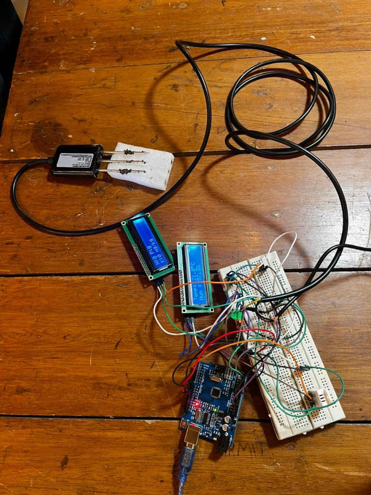
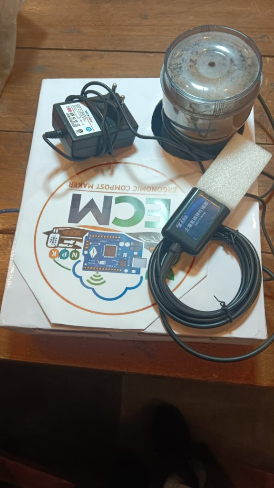
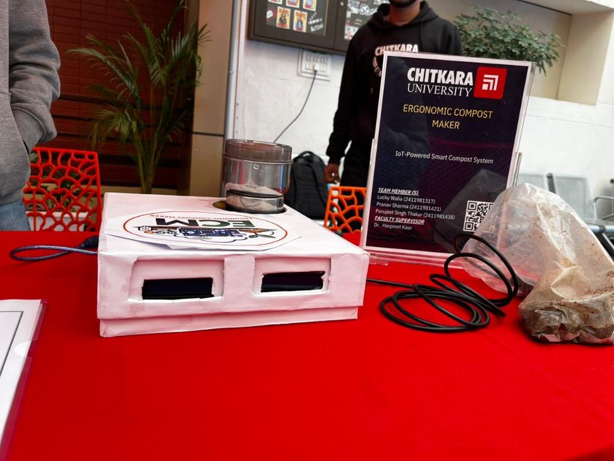
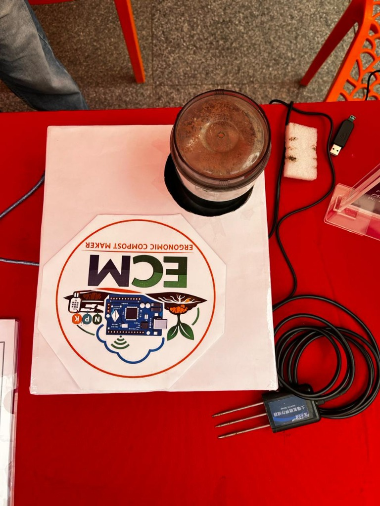
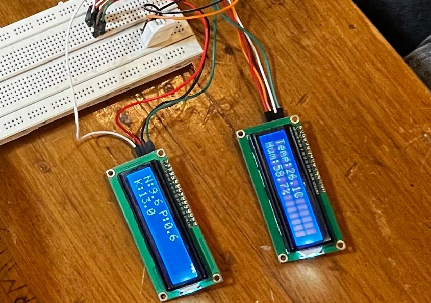
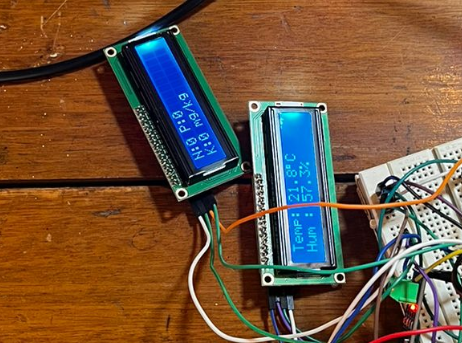
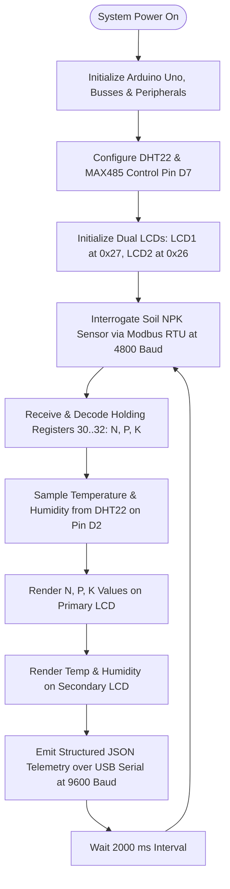
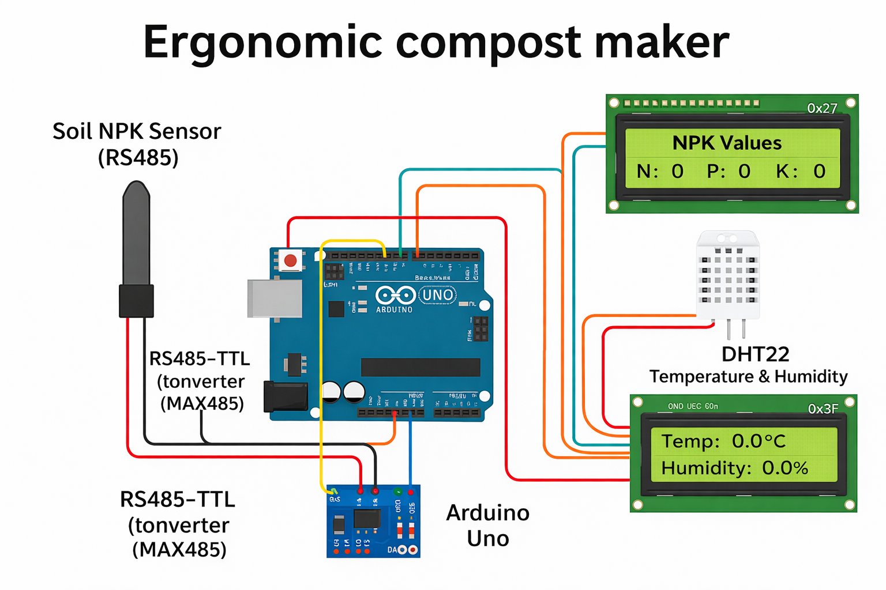
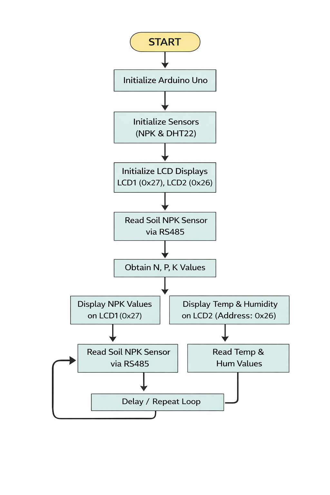
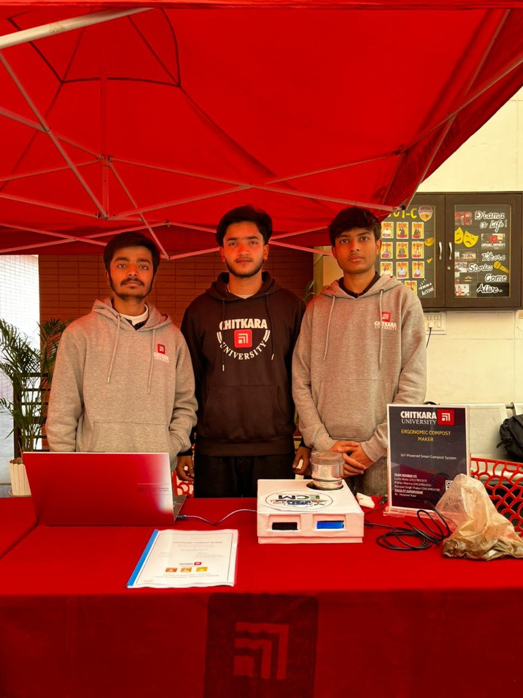

<div align="center">

# 🌱 Ergonomic Compost Maker (ECM)
### *Smart Soil Nutrient (NPK) & Climate Monitoring System for Accelerated Composting*

[](https://www.arduino.cc/)
[](https://isocpp.org/)
[](https://en.wikipedia.org/wiki/Modbus)
[](https://en.wikipedia.org/wiki/I%C2%B2C)
[]()
[](./LICENSE)

<br/>

<!-- QUICK NAVIGATION BAR -->
### ⚡ Quick Navigation

| 💻 [Code & Firmware](./code/) | 📸 [Pictures Gallery](./pictures/) | 🔌 [Circuit & Pinouts](./hardware/) | 📊 [Soil Test Data](./experiments/) | 📄 [Project Report](./docs/) |
| :---: | :---: | :---: | :---: | :---: |

<br/>

<p align="center">
  
  &nbsp;
  
</p>

*Figure 1: Complete Ergonomic Compost Maker (ECM) physical prototype, showing the top-loading motorized mixing chamber, industrial RS485 Soil NPK probe, and dual-screen LCD telemetry.*

</div>

---

## 📌 Executive Summary

Traditional organic composting requires intensive manual labor (continuous pitchfork mixing and turning) and offers zero visibility into whether soil decomposition is actually succeeding or nutrient-deficient. 

The **Ergonomic Compost Maker (ECM)** is a hardware-integrated soil monitoring and composting system designed to solve both problems:
1. **Ergonomic Waste Shredding & Agitation:** Uses an integrated motorized chamber that homogenizes tough kitchen waste peels with soil, maximizing bacterial surface area and eliminating physical strain.
2. **Real-Time NPK Soil Sensing:** Interrogates an industrial-grade **3-prong RS485 Soil NPK Sensor** using **Modbus RTU protocol** to measure primary macro-nutrients (**Nitrogen $N$**, **Phosphorus $P$**, and **Potassium $K$** in $mg/kg$).
3. **Environmental Climate Tracking:** Integrates a **DHT22** sensor to monitor internal compost temperature and relative humidity for optimal decomposition conditions.
4. **Dual-Display Local Telemetry:** Drives two separate 16x2 LCD screens over a shared I2C bus via hardware address separation (`0x27` for NPK nutrient levels, `0x26` for temperature and humidity).

---

## 🧭 Repository Sections & Easy Access Guide

Click any section below to directly view the respective files and documentation:

```
├── 💻 code/                  ──► Arduino UNO firmware, config.h & flashing guide
├── 📸 pictures/              ──► High-resolution photo gallery & circuit diagrams
├── 🔌 hardware/              ──► Bill of Materials, pinouts & wiring tables
├── 📊 experiments/           ──► Real test data with banana/orange peels & leaf litter
└── 📄 docs/                  ──► Complete academic overview, theory & UN SDGs
```

---

## ✨ Key Engineering Highlights

* 🔬 **Industrial RS485 Modbus RTU Communication:** Communicates with the soil probe via differential RS485 signaling (MAX485 transceiver at 4800 baud), providing noise immunity against moisture and electrical interference in soil matrices.
* ⚡ **Dual-Domain Power Distribution:** Safely bridges a 12V excitation rail for the industrial NPK sensor with a 5V digital logic rail for the Arduino UNO and LCD displays using a shared ground plane.
* 🖥️ **Dual-Screen I2C Architecture:** Both 16x2 LCDs operate concurrently on the single hardware I2C bus (`A4`/`A5`) by hardware address selection (`0x27` and `0x26`).
* 🧪 **Empirically Tested with Real Bio-Waste:** Validated across distinct organic feedstocks (banana peel paste, orange peel paste, and dry leaves), proving real-time detection of nutrient spikes and microbial nitrogen immobilization.

---

## 📸 Project Pictures & Visual Showcase

> 💡 *Visit the [**📸 Pictures Gallery**](./pictures/) for full-size images and descriptions.*

<div align="center">

| Soil NPK Sensor Probe | Breadboard Circuit Prototype |
| :---: | :---: |
|  |  |
| *Industrial 3-prong RS485 soil nutrient probe* | *Breadboard prototype with Arduino Uno, MAX485 & dual LCDs* |

| Real-Time NPK Reading (In Soil) | Air Zero-Baseline Check (0-0-0) |
| :---: | :---: |
|  |  |
| *Live readings: $N=9.6$, $P=0.6$, $K=13.0$ / Temp $26.1^\circ\text{C}$, Hum $58.7\%$* | *Zero baseline validation in atmospheric air ($N:0, P:0, K:0$)* |

</div>

---

## 🏗️ System Architecture & Workflow



<div align="center">
  
  <p><em>Figure 2: Complete Hardware Interfacing Schematic of the Ergonomic Compost Maker.</em></p>
</div>

<div align="center">
  
  <p><em>Figure 3: Firmware Workflow Execution Diagram.</em></p>
</div>

---

## 🔬 Empirical Soil Testing & Results

> 💡 *Full datasets and agronomic analysis are available in [`experiments/npk_decomposition_data.csv`](./experiments/npk_decomposition_data.csv) and [`experiments/compost_nutrient_analysis.md`](./experiments/compost_nutrient_analysis.md).*

Controlled decomposition trials were performed to measure the exact nutrient variation before and after adding organic waste:

| Sample / Trial | Organic Feedstock | Nitrogen ($N$) | Phosphorus ($P$) | Potassium ($K$) | Temperature | Humidity | Agronomic Analysis |
| :--- | :--- | :---: | :---: | :---: | :---: | :---: | :--- |
| **SMP-01** | **Control Baseline Soil** | $58\,mg/kg$ | $181\,mg/kg$ | $175\,mg/kg$ | $21.8^\circ\text{C}$ | $57.3\%$ | Native unamended garden soil |
| **SMP-02** | **Banana Peel Paste** | $85\,mg/kg$ *(+27)* | $249\,mg/kg$ *(+68)* | $242\,mg/kg$ *(+67)* | $26.1^\circ\text{C}$ | $58.7\%$ | Strong potassium and phosphorus enrichment from decomposed peel tissue |
| **SMP-03** | **Orange Peel Paste** | $87\,mg/kg$ *(+29)* | $272\,mg/kg$ *(+91)* | $265\,mg/kg$ *(+90)* | $25.9^\circ\text{C}$ | $59.1\%$ | Highest mineral yield; organic acid extraction aids nutrient solubility |
| **SMP-04** | **Dry Fallen Leaves** | $51\,mg/kg$ *(-7)* | $161\,mg/kg$ *(-20)* | $160\,mg/kg$ *(-15)* | $24.2^\circ\text{C}$ | $54.8\%$ | **Nitrogen Immobilization:** High carbon brown waste temporarily bound free soil ions |

> 💡 **The Nitrogen Immobilization Effect:** In Trial 4, adding dry leaves caused a temporary drop in measurable nutrients. Because fallen leaves have a very high Carbon-to-Nitrogen ($C:N$) ratio, decomposer microorganisms absorb available mineral nitrogen ($NO_3^-$, $NH_4^+$) from the soil to synthesize cellular proteins, temporarily locking up nutrients until complete decomposition.

---

## 🧰 Hardware Bill of Materials (BOM)

> 💡 *See [`hardware/bill_of_materials.md`](./hardware/bill_of_materials.md) for full electrical ratings and [`hardware/pinout_and_connections.md`](./hardware/pinout_and_connections.md) for wiring tables.*

| Component | Specification | Operating Voltage | Interface | Role in System |
| :--- | :--- | :--- | :--- | :--- |
| **Microcontroller** | Arduino UNO R3 (ATmega328P) | 5V DC | UART / I2C / GPIO | Master controller & Modbus master |
| **Soil NPK Sensor** | 3-Prong Stainless Steel Probe | 9V – 24V DC (12V) | RS-485 Modbus RTU | In-situ soil Nitrogen, Phosphorus, Potassium sensing |
| **RS485 Transceiver** | MAX485 TTL-to-RS485 Module | 5V DC | TTL UART $\leftrightarrow$ RS485 | Differential physical layer driver |
| **Climate Sensor** | DHT22 / AM2302 Sensor | 3.3V – 5.5V DC | Single-Bus Digital | Internal compost temperature and humidity |
| **Dual Displays** | Dual 16x2 Character LCDs | 5V DC | I2C (`0x27` & `0x26`) | Independent visual readouts for NPK and climate |
| **Power Supply** | 12V 1.5A DC Adapter | 230V AC $\rightarrow$ 12V DC | DC Jack | 12V excitation power for NPK probe |
| **Mixing Chamber** | Motorized Rotary Grinder/Mixer | 12V / 230V AC Motor | Mechanical drive | Ergonomic waste shredding and soil mixing |

---

## ⚡ Quickstart & Code Flashing

1. **Libraries Required:** Install `ModbusMaster` by Doc Walker, `DHT sensor library` by Adafruit, and `LiquidCrystal_I2C` by Frank de Brabander via Arduino IDE.
2. **Wiring:**
   * MAX485 `RO` $\rightarrow$ Pin 10, `DI` $\rightarrow$ Pin 11, `DE` & `RE` $\rightarrow$ Pin 7.
   * MAX485 `A` $\rightarrow$ Sensor Yellow (A), `B` $\rightarrow$ Sensor Blue (B).
   * Sensor Brown $\rightarrow$ +12V DC, Sensor Black $\rightarrow$ Common GND.
   * DHT22 `DATA` $\rightarrow$ Pin 2 with 5V/GND.
   * Both LCDs to `A4` (SDA) and `A5` (SCL) with addresses `0x27` and `0x26`.
3. **Open & Upload:** Open [`code/smart_compost_monitor/smart_compost_monitor.ino`](./code/smart_compost_monitor/smart_compost_monitor.ino), select Arduino Uno and your COM port, then click **Upload**.

---

## 👥 Project Developers & Exhibition Showcase

<div align="center">

| Project Developers | Exhibition Demonstration Stall |
| :---: | :---: |
|  |  |
| *Lucky Walia, Pranav Sharma, and Purujeet Singh Thakur* | *Live hardware demonstration & system evaluation* |

</div>

* **Lucky Walia** – Embedded Hardware Interfacing & Power Distribution
* **Pranav Sharma** – Firmware Architecture & Modbus Communication
* **Purujeet Singh Thakur** – Testing Protocols & Agronomic Data Analysis

**Acknowledgments:**
* Department of Computer Science & Engineering, Chitkara University.

---

## 📄 License

This project is licensed under the **MIT License** — see the [`LICENSE`](./LICENSE) file for details.
