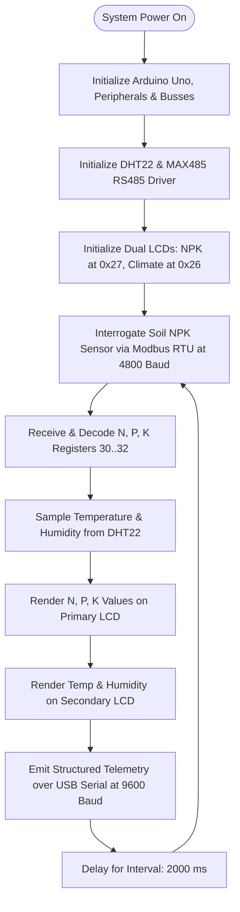

# Ergonomic Compost Maker (ECM) - Project Overview

> **System Type:** Cyber-Physical Soil Health & Composting Telemetry System  
> **Core Technologies:** Embedded C++, Arduino Uno, RS-485 Modbus RTU, I2C, Microclimate Sensing

---

## 🌍 Background & Motivation

Organic kitchen and agricultural waste constitutes nearly **45–50%** of total municipal municipal solid waste. When relegated to unmanaged landfills, organic matter decomposes anaerobically, generating potent methane ($CH_4$) emissions and polluting groundwater through toxic leachate.

While aerobic composting is an ecologically sound recycling technique, conventional home and community composting faces steep adoption barriers:
1. **Physical Labor & Ergonomic Fatigue:** Traditional composting requires frequent manual turning of dense, heavy compost heaps with pitchforks and shovels to maintain aeration.
2. **Guesswork & Lack of Quantitative Insight:** Gardeners and farmers lack low-cost tools to determine whether their compost pile is actively decomposing or stalled.
3. **Imbalanced Nutrient Ratios:** Without visibility into Nitrogen ($N$), Phosphorus ($P$), and Potassium ($K$) levels, users cannot optimize feedstock additions.

The **Ergonomic Compost Maker (ECM)** solves these problems by merging an ergonomic mechanical mixing chamber with an intelligent IoT-enabled sensor telemetry system.

---

## 🎯 Project Objectives

* **Ergonomic Mechanical Agitation:** Minimize physical strain by integrating a compact motorized mixing mechanism that shreds and mixes organic peels directly into the soil.
* **Real-Time Nutrient Quantification:** Interface an industrial RS485 Modbus Soil NPK sensor to dynamically measure $N, P, K$ levels in $mg/kg$.
* **Aerobic Climate Monitoring:** Deploy a high-precision DHT22 sensor to verify that temperature ($20-55^\circ\text{C}$) and relative humidity ($50-65\%$) stay within optimal decomposition brackets.
* **Dual-Display Local Telemetry:** Present metrics on dual dedicated I2C LCD displays for immediate outdoor usability without requiring a phone or laptop.
* **Direct Telemetry Logging:** Stream structured telemetry over USB Serial (9600 baud) for immediate debugging, data collection, and computer-based logging.

---

## 🔄 System Flowchart

The operational control loop follows the state transitions illustrated below:

---

## 🇺🇳 Alignment with UN Sustainable Development Goals (UN SDGs)

* **SDG 2: Zero Hunger**  
  Encourages local production of bio-fertilizer enriched with natural nitrogen, phosphorus, and potassium, enhancing smallholder soil health and crop yields without synthetic chemical fertilizers.
* **SDG 9: Industry, Innovation, and Infrastructure**  
  Applies affordable IoT automation and industrial RS-485 bus communication to everyday agricultural and domestic waste challenges.
* **SDG 11: Sustainable Cities and Communities**  
  Decentralizes municipal organic waste processing, lowering landfill diversion burdens and curbing greenhouse gas emissions right at the source.
