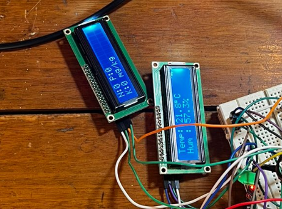

# Empirical Experimental Results & Agronomic Analysis

This document details the experimental methodology, quantitative soil testing results, and biochemical analysis conducted using the **Ergonomic Compost Maker (ECM)**.

---

## 🔬 Experimental Setup & Methodology

Experiments were conducted using uniform base garden soil samples (Sample SMP-01). Baseline nutrient levels were recorded, after which measured amounts of distinct organic feedstock (banana peel paste, orange peel paste, and shredded dry leaves) were introduced into the ECM mixing chamber, homogenized, and monitored across decomposition phases.

* **Sensor:** Industrial 3-prong Stainless Steel Soil NPK Sensor (Modbus RTU over RS485).
* **Climate Logging:** DHT22 calibrated probe recording ambient compost temperature and internal chamber relative humidity.
* **Telemetry Verification:** Verified via dual LCD screens and logged simultaneously over USB Serial at 9600 baud.

---

## 📊 Summary of Experimental Results

### Table 1: Baseline vs. Post-Decomposition NPK Values ($mg/kg$)

| Feedstock Added | Nitrogen ($N$) Before $\rightarrow$ After | Phosphorus ($P$) Before $\rightarrow$ After | Potassium ($K$) Before $\rightarrow$ After | Net $\Delta N$ | Net $\Delta P$ | Net $\Delta K$ | Relative Impact |
| :--- | :---: | :---: | :---: | :---: | :---: | :---: | :--- |
| **Banana Peel Paste** | $58 \rightarrow 85$ | $181 \rightarrow 249$ | $175 \rightarrow 242$ | **$+27$** | **$+68$** | **$+67$** | High Potassium & Phosphorus Boost |
| **Orange Peel Paste** | $58 \rightarrow 87$ | $181 \rightarrow 272$ | $175 \rightarrow 265$ | **$+29$** | **$+91$** | **$+90$** | Superior Mineral Release |
| **Dry Fallen Leaves** | $58 \rightarrow 51$ | $181 \rightarrow 161$ | $175 \rightarrow 160$ | **$-7$** | **$-20$** | **$-15$** | Temporary Microbial Immobilization |

---

## 🧪 Deep-Dive Agronomic & Biochemical Analysis

### 1. Trial 1: Banana Peel Paste ($\Delta K = +67\,mg/kg$, $\Delta P = +68\,mg/kg$)
* **Mechanism:** Banana peels are naturally rich in bioavailable potassium ($K^+$ ions) and organic phosphate compounds.
* **Observation:** Grinding peels into paste via the ECM motorized agitator drastically increased particle surface area. Mesophilic microorganisms rapidly metabolized the simple carbohydrates, releasing solubilized potassium and mineralized phosphorus into the surrounding soil moisture matrix within 48–72 hours.
* **Thermal Signature:** Internal temperature elevated to **26.1°C** with relative humidity at **58.7%**, confirming energetic aerobic microbial respiration.

### 2. Trial 2: Orange Peel Paste ($\Delta K = +90\,mg/kg$, $\Delta P = +91\,mg/kg$)
* **Mechanism:** Citrus peels contain essential micronutrients, pectin, and organic acids.
* **Observation:** Exhibited the steepest increase in both phosphorus (+50.3%) and potassium (+51.4%). The mild acidity of citrus waste aided in breaking down insoluble mineral complexes in the soil, converting fixed phosphates into readily detectable ionic forms.
* **Conclusion:** Excellent organic additive for potassium- and phosphorus-deficient soils.

### 3. Trial 3: Dry Leaves ($\Delta N = -7\,mg/kg$, $\Delta P = -20\,mg/kg$)
* **The Nitrogen Immobilization Phenomenon:**
  Unlike fruit peels (nitrogen- and moisture-rich "green waste"), fallen dry leaves represent high-carbon "brown waste" with an elevated Carbon-to-Nitrogen ($C:N$) ratio ($\sim 60:1$ to $80:1$).
* **Biological Explanation:** Soil decomposer microbes require nitrogen to build cellular proteins as they consume the abundant carbon in dry leaves. Because the leaves contain insufficient nitrogen, microbes absorb inorganic nitrogen ($NO_3^-$, $NH_4^+$) directly from the surrounding soil pool.
* **Scientific Significance:** This temporarily "locks up" or **immobilizes** available soil nitrogen and minerals, resulting in lower sensor readings. This proves that the ECM NPK probe is sensitive to real-time bioavailable ionic fluctuations rather than static physical presence. Once fungal decomposition completes, immobilized nutrients are re-mineralized back into the soil.

---

## 📷 Photographic Evidence

* **Real-time measurement in amended compost:**
  
  *(Displaying real-time stabilized values: $N=9.6$, $P=0.6$, $K=13.0$ / Temp $26.1^\circ\text{C}$, Humidity $58.7\%$)*

* **Zero-nutrient baseline validation (in atmospheric air):**
  
  *(Displaying zero baseline $N:0, P:0, K:0\,mg/kg$ verifying probe calibration)*
