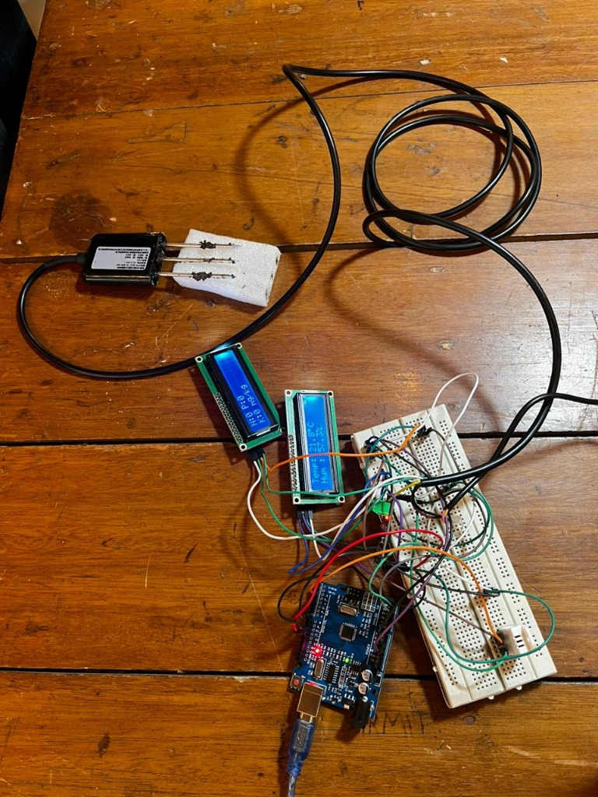
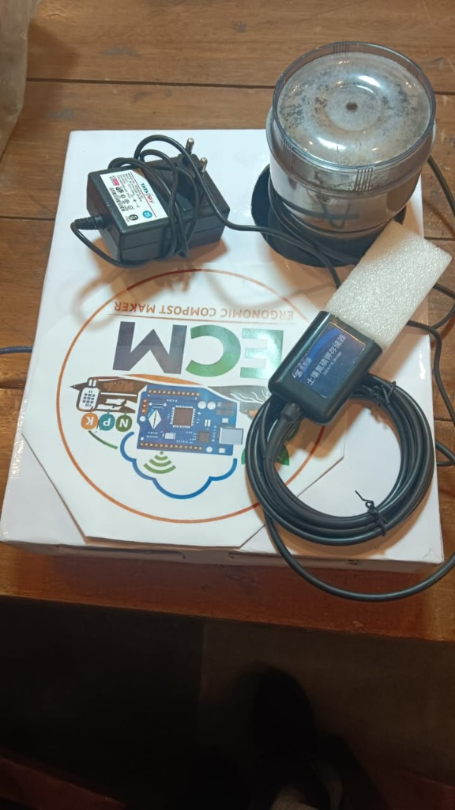
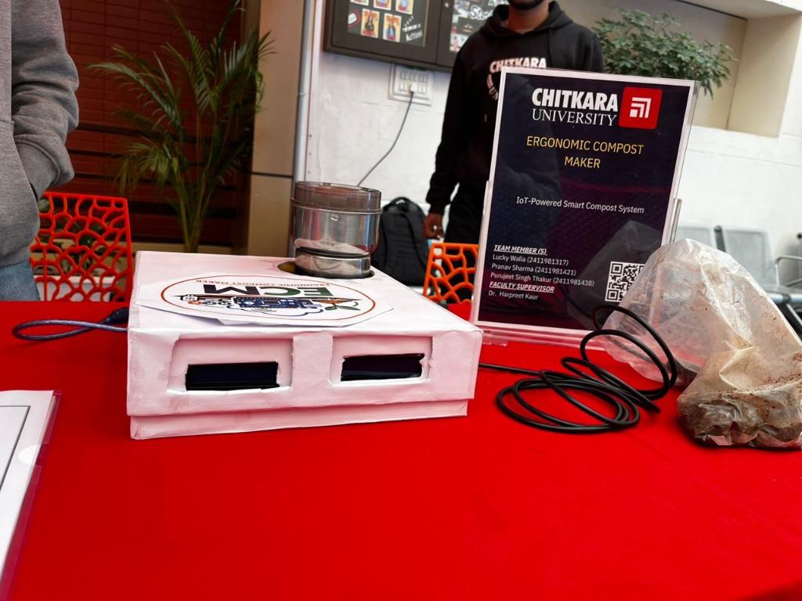
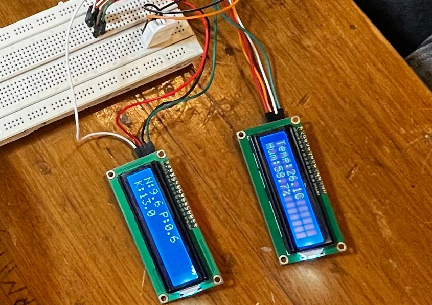
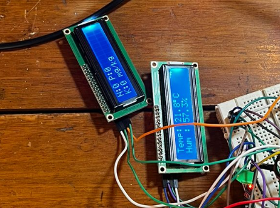
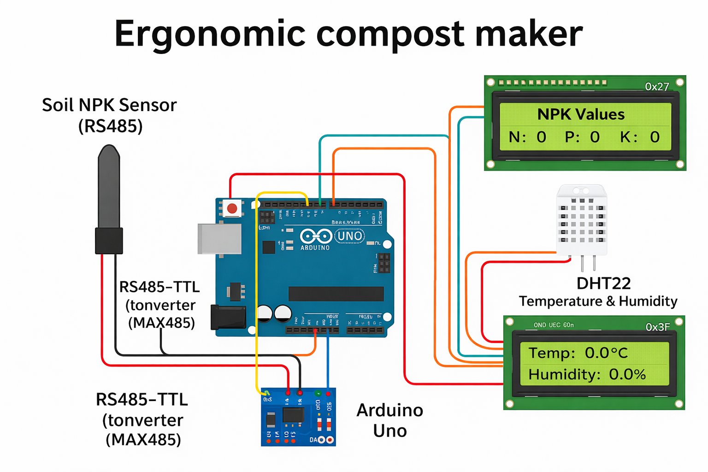
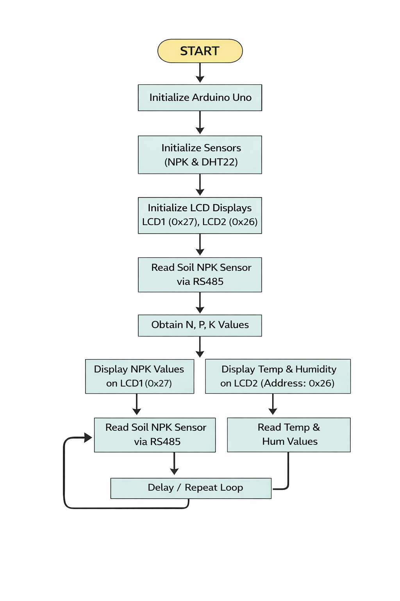
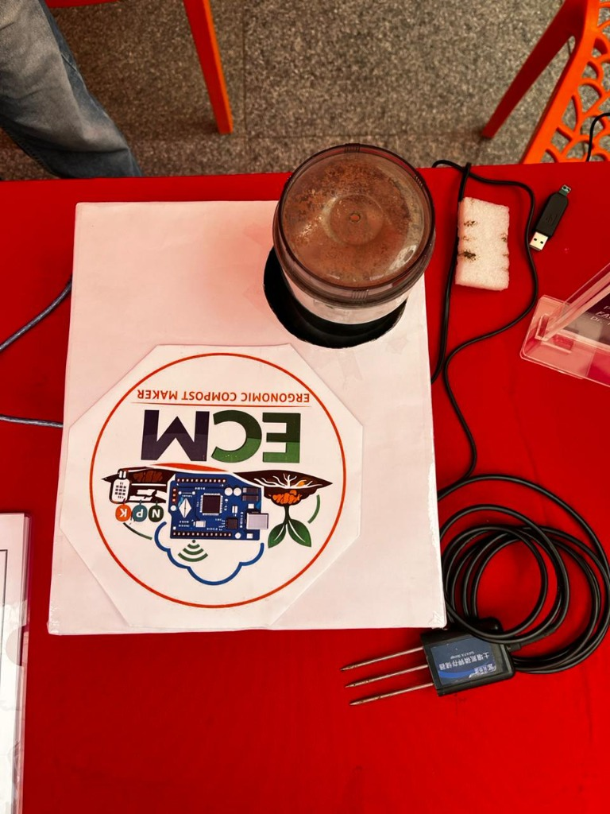
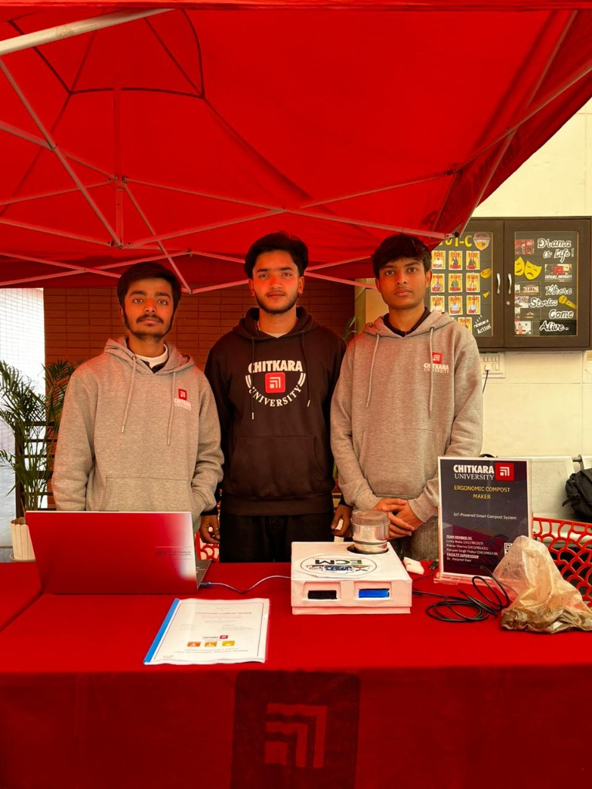

# 📸 Project Pictures & Visual Gallery

This directory contains all hardware photographs, live sensor readout captures, circuit schematics, and exhibition images for the **Ergonomic Compost Maker (ECM)** project.

---

## 🧭 Visual Table of Contents

* [1. Physical Hardware Prototype](#1-physical-hardware-prototype)
* [2. Soil NPK Sensor & Testing Probe](#2-soil-npk-sensor--testing-probe)
* [3. Real-Time LCD Display Readings](#3-real-time-lcd-display-readings)
* [4. Circuit Schematic & Flowchart](#4-circuit-schematic--flowchart)
* [5. Breadboard Testing & Prototyping](#5-breadboard-testing--prototyping)
* [6. Project Exhibition & Team](#6-project-exhibition--team)

---

## 1. Physical Hardware Prototype

The enclosed product integrates a motorized organic waste shredder/grinder on top with dual 16x2 LCD telemetry bezels on the front panel.

| Top View (Motorized Chamber & Probe) | Front View (Dual LCD Cutouts) |
| :---: | :---: |
|  |  |
| *Top view showing the ECM machine, waste loading chamber, 12V adapter, and NPK sensor* | *Front panel showing dual 16x2 LCD cutouts for real-time telemetry* |

---

## 2. Soil NPK Sensor & Testing Probe

Industrial-grade 3-prong stainless steel sensor capable of in-situ Nitrogen ($N$), Phosphorus ($P$), and Potassium ($K$) ion detection.

  
  
<em>Industrial RS-485 Modbus RTU Soil NPK probe with stainless steel measurement electrodes.</em>

---

## 3. Real-Time LCD Display Readings

Real-time telemetry verification showing live soil nutrient readings vs. open-air zero baseline calibration.

| Real-Time Reading (In Decomposed Soil) | Open-Air Zero Baseline Validation |
| :---: | :---: |
|  |  |
| *Stabilized values: $N=9.6$, $P=0.6$, $K=13.0\,\text{mg/kg}$ / Temp $26.1^\circ\text{C}$, Humidity $58.7\%$* | *Zero reading verification ($N:0, P:0, K:0\,\text{mg/kg}$) confirming sensor calibration* |

---

## 4. Circuit Schematic & Flowchart

Architectural wiring and execution workflow for the Arduino UNO controller and RS485 transceiver.

  
  
<em>Circuit schematic: Arduino UNO $\leftrightarrow$ MAX485 $\leftrightarrow$ RS485 NPK Sensor $\leftrightarrow$ DHT22 $\leftrightarrow$ Dual I2C LCDs.</em>

  
  
<em>Firmware execution flow diagram for sensor interrogation and display updates.</em>

---

## 5. Breadboard Testing & Prototyping

Initial bench testing and wiring verification before mounting inside the custom product chassis.

  
  
<em>Functional bench test setup showing Arduino UNO, MAX485 module, DHT22 sensor, and dual I2C LCDs active simultaneously.</em>

---

## 6. Project Exhibition & Team

Demonstration and defense of the Ergonomic Compost Maker at Chitkara University.

| Team Members | Exhibition Stall |
| :---: | :---: |
|  |  |
| *Lucky Walia, Pranav Sharma, and Purujeet Singh Thakur* | *Exhibition stall with live prototype and compost samples* |

